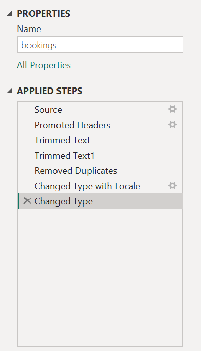
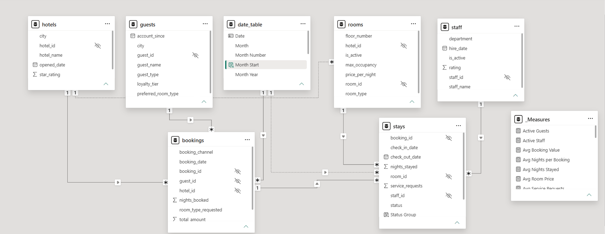
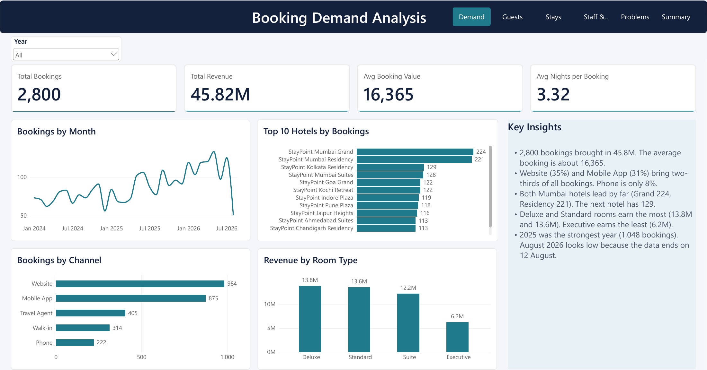
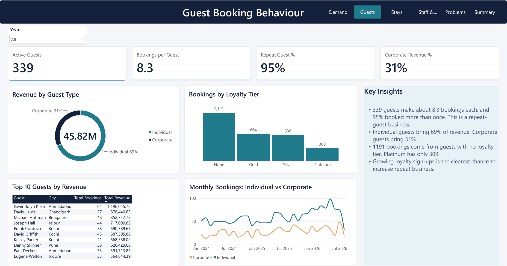
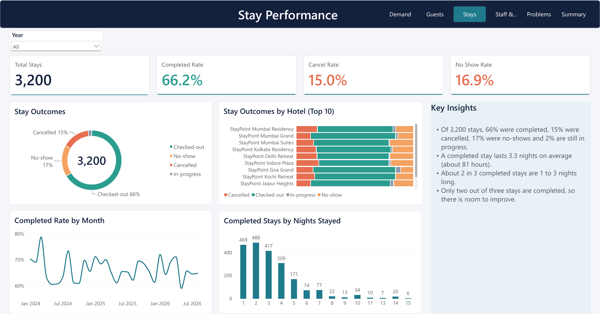
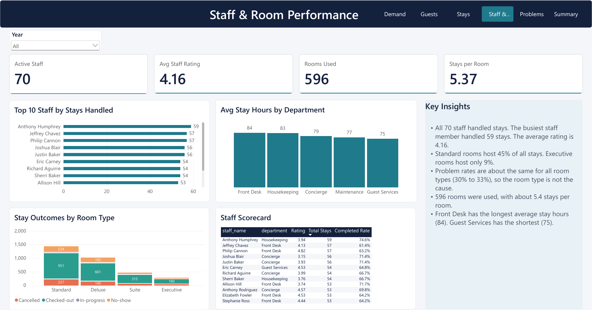
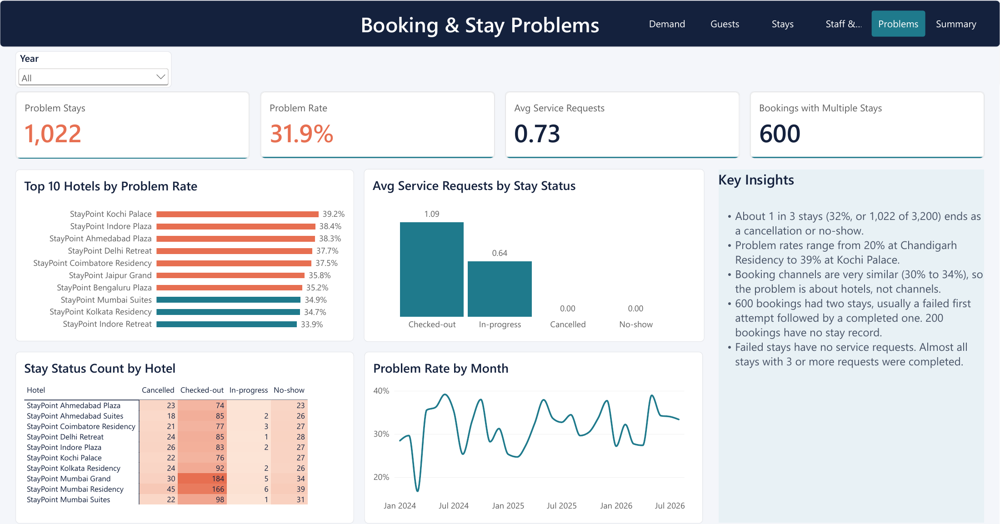
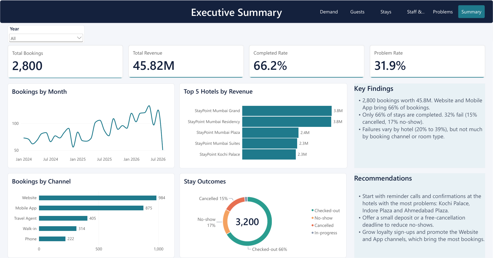

# Hotel Reservation Operations Analytics (Power BI)

An end-to-end Power BI project for **StayPoint Hospitality**, a hotel chain with properties across many Indian cities. I worked as a BI analyst supporting the Operations team: cleaning raw data, building a data model, defining KPIs, writing DAX measures, and designing a 6-page interactive dashboard.

Project completed as part of the Data Science program at **Innomatics Research Labs**.

## Business Problem

The Operations and Guest Experience teams wanted to understand booking demand, guest behaviour, stay outcomes, and staff and room utilization, and to find out why some bookings never turn into completed stays.

## Business Objectives

| # | Objective | Dashboard page |
|---|-----------|----------------|
| 1 | Understand Booking Demand | Demand |
| 2 | Understand Guest Booking Behaviour | Guests |
| 3 | Evaluate Stay Performance | Stays |
| 4 | Understand Staff and Room Performance | Staff & Rooms |
| 5 | Identify Booking and Stay Problems | Problems |
| 6 | Executive Summary | Summary |

## Dataset

Seven tables loaded into Power BI Desktop: `bookings` (2,800 rows), `stays` (3,200 rows), `guests` (~350), `rooms` (~600), `hotels` (~25), `staff` (70) and `date_table`. Row counts for the smaller tables are the raw file sizes from the project brief. The raw CSV files are not included in this repository.

## Approach

1. **Data cleaning (Power Query):** trimmed text, removed duplicate rows, and set correct data types. All steps are visible in the Applied Steps pane.
2. **Data modeling:** star-style model where `hotels`, `guests`, `rooms`, `staff` and `date_table` filter the `bookings` and `stays` fact tables. `bookings` link to `stays` through `booking_id`. Inactive relationships are shown as dotted lines. DAX measures are organised in a separate `_Measures` table.
3. **KPIs and DAX:** measures such as Active Guests, Active Staff, Avg Booking Value, Avg Nights per Booking, Avg Nights Stayed, Avg Room Price, completed rate, cancel rate, no-show rate and problem rate.
4. **Dashboard design:** one page per objective plus an executive summary, with a year slicer and a custom `StayPoint` theme.

### Power Query: Applied Steps


### Data Model


## Dashboard Pages

### 1. Booking Demand


### 2. Guest Booking Behaviour


### 3. Stay Performance


### 4. Staff & Room Performance


### 5. Booking & Stay Problems


### 6. Executive Summary


## Key Findings

- **2,800 bookings** brought in **45.82M** in revenue, with an average booking value of about 16,365.
- **Website (35%) and Mobile App (31%)** bring two-thirds of all bookings. Phone is only 8%.
- Both **Mumbai hotels lead** (Grand 224 and Residency 221 bookings); the next hotel has 129.
- **Deluxe and Standard** rooms earn the most (13.8M and 13.6M). Executive earns the least (6.2M).
- **95% of guests booked more than once**, so this is a repeat-guest business, yet 1,191 bookings come from guests with no loyalty tier.
- Individual guests bring **69%** of revenue and corporate guests **31%**.
- Only **66.2%** of 3,200 stays were completed; **15.0%** were cancelled and **16.9%** were no-shows.
- The **problem rate is 31.9%** and ranges from **20% (Chandigarh Residency) to 39% (Kochi Palace)** by hotel. It stays similar across booking channels (30% to 34%) and room types (30% to 33%), so the issue is hotel-specific.

## Recommendations

1. Start reminder calls and confirmations at the hotels with the most problems: Kochi Palace, Indore Plaza and Ahmedabad Plaza.
2. Offer a small deposit or a free-cancellation deadline to reduce no-shows.
3. Grow loyalty sign-ups and promote the Website and App channels, which bring the most bookings.

## Repository Structure

```
Hotel-Reservation-Analytics-PowerBI/
├── powerbi/        # .pbix file and StayPoint theme (JSON)
├── report/         # Exported PDF of the full report
├── docs/           # Project brief and documentation
└── assets/         # Dashboard, data model and Power Query screenshots
```

## How to Open

Open `powerbi/Hotel_Reservation_Analytics.pbix` in **Power BI Desktop**. To preview without Power BI, see `report/Hotel_Reservation_Analytics.pdf`.

## Tools

Power BI Desktop, Power Query, DAX

## Author

**Venkatesh Reddy Munagala**
[LinkedIn](https://www.linkedin.com/in/venkatesh-reddy-munagala-77b285425) | [GitHub](https://github.com/venkateshreddy-datascience)
